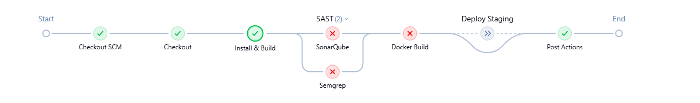
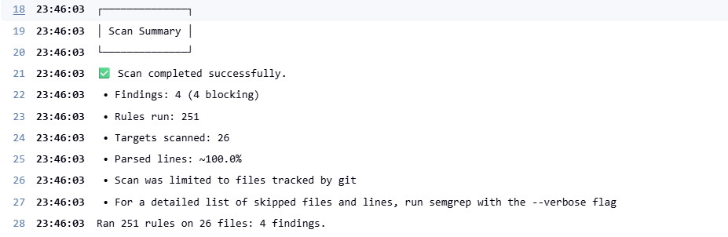
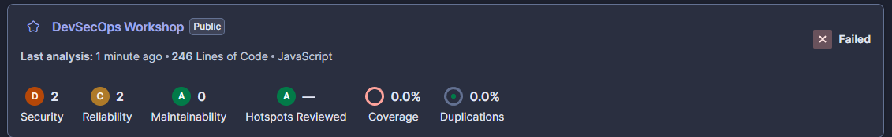

# DevSecOps Workshop

Application Next.js **volontairement vulnérable** + pipeline Jenkins (SonarQube + Semgrep).
⚠️ Ne jamais déployer en production.

## 1. Démarrer l'infra

```bash
# Linux uniquement (requis par SonarQube/Elasticsearch)
sudo sysctl -w vm.max_map_count=262144

docker compose up -d --build
```

| Service   | URL                   | Accès initial                                  |
|-----------|-----------------------|------------------------------------------------|
| Jenkins   | http://localhost:8080 | mot de passe: `docker logs jenkins`            |
| SonarQube | http://localhost:9000 | admin / admin (changement demandé au 1er login)|
| Staging   | http://localhost:3001 | créé par le pipeline                           |

## 2. Configurer Jenkins

1. Terminer l'assistant d'installation (les plugins nécessaires sont déjà préinstallés).
2. SonarQube: *My Account > Security > Generate Tokens* (type *User*) et copier le token.
3. Jenkins: *Manage Jenkins > Credentials > Global > Add Credentials*
   - Kind: **Secret text**, Secret: le token Sonar, ID: **`sonar-token`**
4. Pousser ce projet sur un dépôt Git (GitHub, Gitea...).
5. Jenkins: *New Item > Pipeline > Pipeline script from SCM* > Git > URL du dépôt, branche, Script Path `Jenkinsfile`.
6. *Build Now*.

## 3. Pipeline

`Checkout` > `Install & Build` > `SAST (SonarQube || Semgrep)` > `Docker Build` > `Deploy Staging`

Le stage `SAST` **fait échouer le build** en cas de violation :

- **SonarQube** : le scanner attend le résultat du Quality Gate (`sonar.qualitygate.wait=true`, timeout 5 min).
- **Semgrep** : `--error` retourne un code de sortie non nul dès qu'une règle est déclenchée.
- Les deux scanners tournent en parallèle et vont jusqu'au bout (`failFast false`), donc les deux rapports sont toujours produits.
- Si le SAST échoue, `Docker Build` et `Deploy Staging` ne sont pas exécutés.

Rapports :
- Semgrep : artefacts du build (`semgrep-report.json`, `semgrep.sarif`)
- Sonar : http://localhost:9000, projet `devsecops-workshop`
## 3 bis. Configurer le Quality Gate SonarQube

Ne pas utiliser le gate par défaut "Sonar way" : il porte sur le *nouveau code* et exige une couverture de tests, ce qui ferait échouer le build pour une mauvaise raison.

1. SonarQube > **Quality Gates** > **Create** > nom : `Workshop Gate`
2. Ajouter ces conditions sur **Overall Code** :
   - Security Rating pire que **A**
   - Security Hotspots Reviewed inférieur à **100%**
   - Reliability Rating pire que **A**
3. **Set as Default** (ou l'affecter au projet `devsecops-workshop`)

> La condition sur les Security Hotspots est importante : SonarQube Community détecte mal les injections (pas d'analyse de taint) et classe plusieurs failles (MD5, `Math.random()`, `exec()`, secrets) en hotspots. Sans cette condition, le gate peut passer alors que l'application est vulnérable. Semgrep, lui, détectera les injections : c'est un bon point de discussion sur la complémentarité des outils.

## 4. Vulnérabilités plantées

| Vulnérabilité               | Fichier                          | Test manuel                                                    |
|-----------------------------|----------------------------------|----------------------------------------------------------------|
| SQL injection (auth bypass) | `app/api/login/route.js`         | user: `admin' --`, mot de passe quelconque                     |
| SQL injection (UNION)       | `app/api/search/route.js`        | `' UNION SELECT id, username, password FROM users --`          |
| XSS stocké                  | `app/comments/page.js`           | commentaire: ``                    |
| Command injection           | `app/api/ping/route.js`          | `/api/ping?host=127.0.0.1;id`                                  |
| Path traversal              | `app/api/file/route.js`          | `/api/file?name=../../package.json`                            |
| Secrets en dur              | `lib/config.js`                  | -                                                              |
| Hash faible (MD5)           | `lib/crypto.js`                  | -                                                              |
| Cookie non sécurisé         | `app/api/login/route.js`         | -                                                              |
| Fuite d'erreur SQL          | `app/api/login/route.js`         | `'` dans le champ user                                         |
| Conteneur en root           | `Dockerfile`                     | (pour le futur scan d'image)                                   |

## 5. Lancer l'app sans Jenkins

```bash
npm install
npm run dev   # http://localhost:3000
```

## 6. Prochaines étapes (à ajouter au Jenkinsfile)

## 6. Prochaines étapes

### 6.1 OWASP ZAP (DAST)

Après `Deploy Staging`, un nouveau stage `DAST` scanne l'application déployée.

- **Cible** : `http://devsecops-staging:3000` (le staging est sur le réseau Docker `devsecops`, donc ZAP l'atteint par son nom de conteneur).
- **Outil** : image `ghcr.io/zaproxy/zaproxy:stable`, mode *baseline scan* (scan passif, rapide, adapté à un workshop).
- **Rapports** : `zap-report.html` et `zap-report.json`, archivés comme artefacts du build.
- **Comportement** : le build est d'abord en *observation* (pas d'échec), puis on active l'échec sur les alertes de niveau élevé, comme pour le SAST.
- **Ce que ZAP détecte** : en‑têtes de sécurité manquants, cookies sans `HttpOnly`/`Secure`, fuite d'informations dans les erreurs. Il ne trouvera pas toutes les injections en mode baseline : c'est un bon point de discussion sur la complémentarité SAST / DAST.

### 6.2 Dependabot (SCA)

Dependabot surveille les dépendances et ouvre automatiquement des Pull Requests de mise à jour. Il ne tourne **pas** dans Jenkins : c'est une fonctionnalité de GitHub.

1. Ajouter `.github/dependabot.yml` :
```yaml
   version: 2
   updates:
     - package-ecosystem: "npm"
       directory: "/"
       schedule:
         interval: "weekly"
       open-pull-requests-limit: 5
     - package-ecosystem: "docker"
       directory: "/"
       schedule:
         interval: "weekly"
```
2. Activer dans GitHub : *Settings > Code security* > **Dependabot alerts** et **Dependabot security updates**.
3. Intégration avec Jenkins : chaque PR Dependabot doit déclencher le pipeline, pour vérifier que la mise à jour ne casse rien et passe les scans.
   - Utiliser un job **Multibranch Pipeline** (ou GitHub Branch Source) au lieu d'un Pipeline simple.
   - Configurer un webhook GitHub vers Jenkins (`/github-webhook/`). Jenkins tournant en local, exposer le port 8080 avec un tunnel (ngrok, cloudflared) pour le workshop.
4. Le projet utilise volontairement `next@14.2.15`, qui a des vulnérabilités connues : Dependabot proposera donc des mises à jour dès l'activation.

> Dependabot fonctionne uniquement avec un dépôt GitHub. Avec GitLab ou Gitea, utiliser Renovate à la place.
## 7. Résultats : avant / après

Le pipeline est d'abord exécuté sur le code **vulnérable**, puis sur le code **corrigé**.

### 7.1 Avant : code vulnérable

Le build échoue au stage `SAST` : le Quality Gate SonarQube est en échec et Semgrep bloque sur ses findings. Les stages `Docker Build` et `Deploy Staging` ne sont pas exécutés.

**Pipeline Jenkins**



**Semgrep** : 4 findings bloquants (251 règles, 26 fichiers analysés)



**SonarQube** : Quality Gate *Failed* (Security D, Reliability C)



### 7.2 Corrections appliquées

| Vulnérabilité | Fichier | Correctif |
|---|---|---|
| Injection SQL (login) | `app/api/login/route.js` | Requête paramétrée (`?`) |
| Injection SQL (recherche) | `app/api/search/route.js` | Requête paramétrée (`LIKE ?`) |
| XSS stocké | `app/comments/page.js` | Rendu en texte (`{c.body}`), suppression de `dangerouslySetInnerHTML` |
| Injection de commande | `app/api/ping/route.js` | Suppression de `exec`, résolution via `dns.lookup` + validation du format |
| Path traversal | `app/api/file/route.js` | Liste blanche des fichiers du dossier autorisé |
| Secrets en dur | `lib/config.js` | Lecture de `SESSION_SECRET` (env) ou secret aléatoire |
| Hash MD5 | `lib/crypto.js` | `scrypt` avec sel aléatoire et comparaison à temps constant |
| Cookie non sécurisé | `app/api/login/route.js` | `HttpOnly`, `Secure`, `SameSite=Strict`, jeton via `crypto.randomBytes` |
| Fuite d'erreurs SQL | routes API | Message générique côté client, détail dans les logs serveur |

